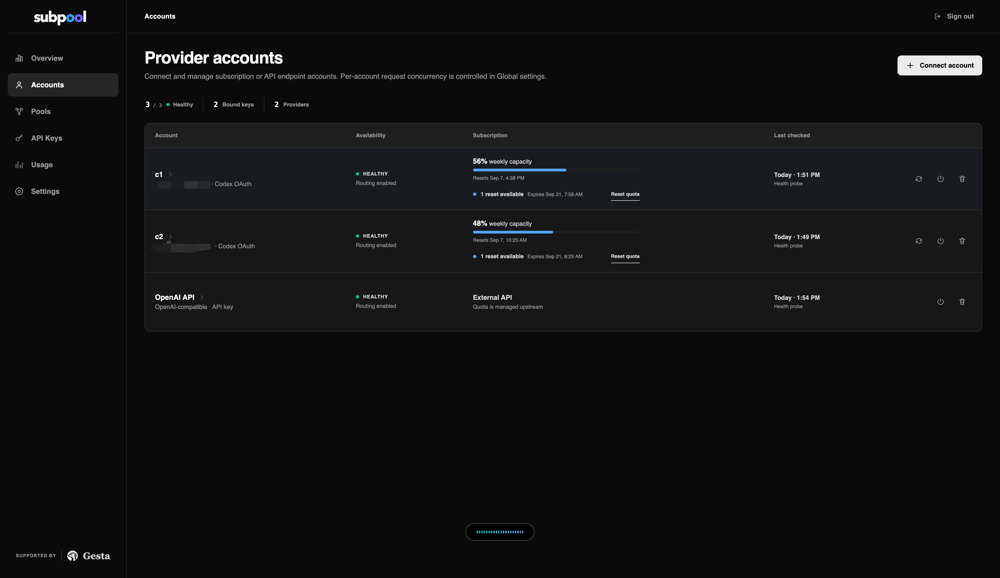
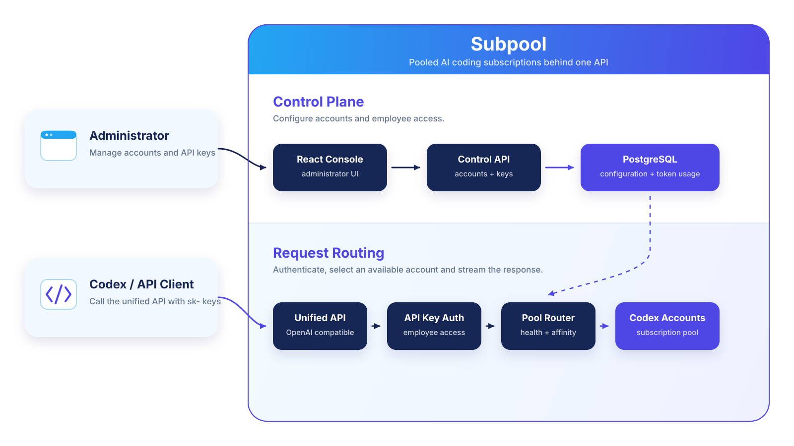

<p align="center">
  
  
</p>

<p align="center">
  Enterprise AI subscription quota allocation and governance, self-hosted.
</p>

<p align="center">
  
  
  
  
</p>

Subpool is a self-hosted control plane for allocating, governing, and auditing AI subscription capacity across teams. Administrators combine authorized subscription and API accounts into pools, distribute employee-specific keys, monitor remaining quota, and expose one consistent API without storing conversation content.

[Release pages](https://gesta-run.github.io/subpool/) publish the current version, immutable container image coordinates, source commit, and complete notes from GitHub Releases.

<p align="center">
  
</p>

## Features

- Pool authorized subscription and API capacity behind one managed endpoint.
- Allocate employee-specific keys across healthy provider accounts.
- Monitor account health, remaining subscription capacity, and reset availability.
- Keep key-to-account assignments visible and auditable.
- Prefer subscription capacity and fall back to paid API accounts with the same employee key.
- Rate-limit, expire, and revoke employee access independently.
- Expose OpenAI-compatible Responses and Chat Completions APIs.
- Track aggregate input and output token telemetry per API key and subscription quota in provider-native units.
- Encrypt upstream credentials and never persist prompts, responses, or source code.

## Architecture

For the internal protocol boundaries and request lifecycle, see [Provider adapters](docs/provider-adapters.md).



Subpool is a single Go service with an embedded React console and PostgreSQL persistence.

## Quick start

Requires Docker Engine and Docker Compose.

```bash
cp .env.example .env

# Generate independent secrets and place them in .env.
openssl rand -base64 32
openssl rand -base64 32
openssl rand -hex 32

docker compose up -d
```

Replace every `replace-with-*` value. Docker Compose pulls the latest published Subpool image from ECR Public; no local image build is required. Open [http://localhost:8081](http://localhost:8081) and sign in with the administrator credentials from `.env`. The employee API remains on [http://localhost:8080](http://localhost:8080).

## Connect and use

### Bailian Token Plan quota

Beijing Token Plan personal endpoints support automatic five-hour, weekly, or
monthly quota display, depending on the windows reported by the subscription.
Connect the endpoint as an OpenAI-compatible account, then select
**Connect quota** in its account row. Choose either authorization method:

- **Browser token (temporary):** sign in through the official Bailian CLI browser
  flow using the subscription owner, then import its console access token in the
  dialog or through the authenticated quota API. Repeat sign-in when it expires;
  this token cannot renew itself. The dialog does not start a hosted OAuth flow.
- **RAM AccessKey (automatic renewal):** supply keys from the same subscription,
  with Token Plan read permissions in RAM and subscription access in Bailian
  account permissions. The integration uses the official CLI gateway and renews
  authorization automatically. No CLI installation is needed on the server.

Delegated console contexts can also pass `console_switch_agent` in the quota API.

Quota credentials are encrypted within the account's credential record and are never returned by the API. Quota query errors
retain the last known values and do not disable inference. **Disconnect quota**
removes only the quota credentials. Other regions, team Credits, Coding Plan,
and pay-as-you-go balances are not covered by this integration.

### Client setup

1. Open **Accounts** and connect a Codex, GitHub Copilot, Google Antigravity, or OpenAI-compatible account.
2. Create a pool and add the account.
3. Create an employee API key for the pool.

For authorization methods, supported endpoints, and provider-specific limitations, see [Provider accounts](docs/provider-accounts.md).

After creating an employee API key, configure Codex on each user's machine to route requests through Subpool. Edit the user-level Codex configuration file:

- Linux: `/home/<username>/.codex/config.toml` (or `~/.codex/config.toml`)
- macOS: `/Users/<username>/.codex/config.toml` (or `~/.codex/config.toml`)
- Windows: `C:\Users\<username>\.codex\config.toml` (or `%USERPROFILE%\.codex\config.toml`)

Create the `.codex` directory and `config.toml` file if necessary. Replace `https://subpool.example.com` with your Subpool URL and `sk-example-not-a-real-key` with the employee API key created in Subpool.

```toml
model = "gpt-5.6-sol"
model_provider = "subpool"
model_reasoning_effort = "xhigh"

[model_providers.subpool]
name = "Subpool"
base_url = "https://subpool.example.com/v1"
wire_api = "responses"
experimental_bearer_token = "sk-example-not-a-real-key"
requires_openai_auth = false
supports_websockets = true

[features]
responses_websockets_v2 = true
```

Save the file, then restart Codex so the new provider and WebSocket settings are loaded. Codex subscription accounts normally use a dedicated upstream WebSocket, while GitHub Copilot and OpenAI-compatible accounts use the HTTP/SSE bridge.

#### Optional: Codex V2 compaction with GitHub Copilot

Deploy a Subpool build containing the V2 compaction adapter **before** enabling
this setting. On a Codex version supporting the
[remote compaction capability](https://learn.chatgpt.com/docs/config-file/config-reference),
add the following table to the configuration above, then restart Codex:

```toml
[model_providers.subpool.capabilities]
remote_compaction = "v2"
```

This opts the provider into sending `compaction_trigger` items through Responses.
For Copilot accounts, Subpool summarizes history with bounded inference calls,
returns a Subpool-owned encrypted compaction item, and restores that item before
later inference. Internal summary calls consume upstream capacity and add latency.
Streaming clients receive lifecycle and content-free progress events while work
is pending; the usable compaction item is returned only after complete success.
The legacy `/v1/responses/compact` endpoint remains available for clients that
install a complete plaintext replacement window.

The client must still trigger compaction; this is not automatic recovery from
every HTTP 413. Set client compaction thresholds for the selected model's actual
context window. Large images, tool definitions, or retained instructions can
still exceed upstream limits, regardless of Subpool's request-size setting.
Do not enable V2 against an older Subpool deployment or a pool whose other
upstreams do not support it. Omitting the setting keeps Codex's provider default;
the tested custom-provider configuration used local compaction by default.

Compaction state is bound to the employee API key's identity and Subpool's
credential encryption key. Replacing the employee API key or rotating the
encryption key invalidates existing state; replay the full conversation or start
a new session.
See [compaction protocol and limits](docs/provider-adapters.md) for tested client
versions, replay requirements, and unsupported input types.

## API and networking

Available API endpoints include `GET/POST /v1/responses`, `POST /v1/responses/compact`, `POST /v1/chat/completions`, `POST /v1/images/generations`, `POST /v1/images/edits`, `GET /v1/models`, `GET /healthz`, `GET /readyz`, and `GET /metrics`.

`subpool_codex_routing_requests_total` observes Codex routing boundaries with fixed `transport` (`http`, `websocket`) and `binding` labels:

- `unbound`: no previous response and no existing WebSocket account binding.
- `continuation`: the request supplies a previous response ID, including the first request after reconnecting.
- `connection`: no previous response ID, but the WebSocket already has an account binding.

HTTP requests are counted once after initial account resolution, before upstream attempts; accepted WebSocket turns are counted once before forwarding. Retries and HTTP bridge attempts do not add requests. Image requests and other providers are excluded. Counters reset on process restart and contain no employee identifiers, credentials, request bodies, or response IDs. Compare deltas from the same process lifetime and allow a warm-up period after deployment. `unbound` identifies an opportunity under the current routing contract, not a guarantee of cross-account replay safety, available alternative capacity, or a share of consumed quota. These metrics do not change routing.

Subpool always serves two listeners. `SUBPOOL_API_LISTEN_ADDRESS` exposes the employee API and operational endpoints, while `SUBPOOL_CONSOLE_LISTEN_ADDRESS` exposes the console and its `/api/v1/*` control API. For Compose deployments, `SUBPOOL_PORT` and `SUBPOOL_CONSOLE_PORT` select their host ports. The pre deployment uses `SUBPOOL_HOST_PORT` (API, default `8082`) and `SUBPOOL_CONSOLE_HOST_PORT` (console, default `8083`).

## Deployment notes

- Terminate TLS at a reverse proxy and set `SUBPOOL_PUBLIC_URL` to the console's public origin.
- Back up PostgreSQL together with `SUBPOOL_CREDENTIAL_KEY` and `SUBPOOL_API_KEY_HMAC_KEY`.
- Use PostgreSQL for shared authentication, rate-limit, assignment, and health state across replicas.
- Responses WebSockets allow up to 32 connections per employee API key and 256 per process. Idle connections count toward these limits and close after five minutes without pending work. Active turns remain limited to 16 per connection and 16 per upstream account. A connection over either limit receives HTTP 503 with `subpool_capacity_exceeded`; existing connections stay open. `subpool_responses_ws_connection_rejections_total{reason="per_key_limit|global_limit|closing"}` distinguishes capacity and shutdown rejections, alongside the existing total counter. These counters reset on restart.
- HTTP and Responses WebSocket request bodies default to 256 MiB per request, a 1 GiB estimated buffer budget per process, and a five-minute read timeout. Administrators can change both size limits in **Settings → Request limits** (MiB). Saved limits override the environment defaults and apply to each new HTTP request or WebSocket message across instances sharing the database, without restarting. In-flight requests keep their original limits and continue to count against the shared process budget; reducing the budget may temporarily reject new requests until old reservations finish. Before limits are saved, `SUBPOOL_MAX_REQUEST_BODY_BYTES` and `SUBPOOL_MAX_INFLIGHT_REQUEST_BODY_BYTES` supply the defaults. The timeout remains controlled by `SUBPOOL_REQUEST_BODY_READ_TIMEOUT`. Choose values that fit the available memory; the buffer budget must be at least four times the per-request limit. These settings do not change upstream provider limits.
- GitHub Copilot uses the bundled public OAuth client ID by default. `SUBPOOL_COPILOT_CLIENT_ID`, `SUBPOOL_COPILOT_API_BASE`, `SUBPOOL_COPILOT_TOKEN_EXCHANGE_URL`, and `SUBPOOL_COPILOT_ENTITLEMENTS_URL` are optional upstream overrides; most deployments should leave them unchanged.
- Google Antigravity requires a matching authorized OAuth client pair in `SUBPOOL_ANTIGRAVITY_CLIENT_ID` and `SUBPOOL_ANTIGRAVITY_CLIENT_SECRET`. Both default to empty; no Google client credentials are bundled. After deployment configuration, choose **Authorize Google**, sign in with an eligible account, and paste the complete callback URL. This is not a Gemini API-key endpoint. See [authorization, supported APIs and limitations](docs/provider-accounts.md#google-antigravity) before connecting an account.

See [.env.example](.env.example) for configuration options.

## Development

```bash
make compose-dev-up
make web-install
make dev
```

`compose.dev.yaml` builds `subpool:local` from the current source tree instead of pulling the published image.

Before opening a pull request:

```bash
make web-test
make web-build
go test ./...
```

## Terms

Subpool is licensed under the [Apache License 2.0](LICENSE). It is independent and self-hosted. Use only accounts you are authorized to manage, and review each upstream provider's terms before sharing access.

### Opt-in Codex quota routing

Set `SUBPOOL_CODEX_QUOTA_ROUTING=true` to prefer more remaining subscription
capacity for independent, non-image Codex requests and the first unbound
WebSocket turn. The default is `false`, including self-hosted deployments.
Existing `previous_response_id` chains and established WebSockets keep their
account; the policy does not migrate or replay them. API keys and client
configuration stay unchanged. New keys still use the existing allocation
policy; their first eligible request can update their default account.

The score is the smallest remaining percentage of the available five-hour and
weekly windows. At least one window must be present. Quota must be checked
within 15 minutes and error-free; every present window must have a valid usage
percentage and a future reset timestamp. An omitted window is not assumed to
have zero or unlimited capacity. A candidate must improve the score by more than
five percentage points and have the same plan, provider, priority, credential
type, and fast-mode setting. Health, cooldown and key-capacity checks still
apply. Equal scores prefer lower weighted key count. Missing or stale data
keeps the current binding; normal availability failover remains unchanged.

`subpool_codex_quota_routing_switches_total` counts committed default-binding
changes and resets on process restart, like the routing observation counters.
Compare quota snapshots and failures over time; request counts alone do not
measure quota consumption. Direct upstream usage can also change the balance.
Set the flag back to `false` and restart to stop further quota-based changes;
existing defaults and response bindings remain valid.

## Daily team email

Optional daily usage emails run inside the service and send through Resend. They are disabled by default. Configure these deployment variables:

| Variable | Purpose |
| --- | --- |
| `SUBPOOL_DAILY_REPORT_ENABLED` | Enable the daily email (`false` by default). |
| `SUBPOOL_RESEND_API_KEY` | Resend API key, kept in deployment secrets. |
| `SUBPOOL_DAILY_REPORT_FROM` | Verified sender, for example `SubPool <reports@example.com>`. |
| `SUBPOOL_DAILY_REPORT_TO` | Comma-separated team recipients or a mailing group. |
| `SUBPOOL_DAILY_REPORT_TIME` | Local send time, default `17:50`. |
| `SUBPOOL_DAILY_REPORT_TIMEZONE` | IANA timezone, default `Asia/Shanghai`. |

The email contains each Codex account's completed-response count and share, remaining weekly capacity, and reset time. Request counts include completed/incomplete HTTP responses and WebSocket turns with a response ID, deduplicated by key and response. Failed requests, internal probes, and direct account traffic are excluded; upstream capacity includes direct usage. The initial email explicitly states its partial tracking window. Historic requests before installation are not reconstructed from session expiry timestamps.

The database preserves counters and the frozen daily email across restarts. A database lease prevents concurrent sends; retries reuse the frozen body and Resend idempotency key, with a bounded attempt count. An instance that restarts after the send time catches up for that day. It does not replay previous days. Stale or missing quota displays as unavailable, never as zero.
